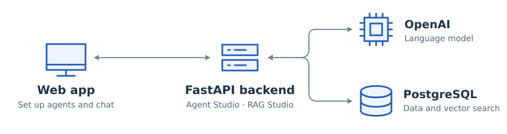
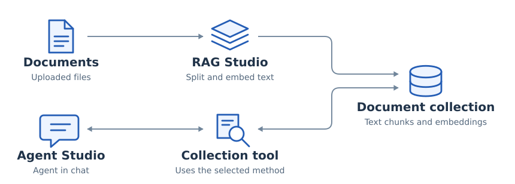

# AI Agent Factory — Agent Studio

AI Agent Factory lets users choose what an agent can do and which documents it can search. During my internship at Abysalto AI Academy, I built the **project and agent APIs** and connected **Agent Studio** to **RAG Studio** so an agent could look up documents during a chat.

**Python · FastAPI · Pydantic · SQLAlchemy · PostgreSQL · LangGraph · LangChain · pytest**

*Abysalto AI Academy · Summer 2025 · Six interns in two teams*

## Architecture

Agent Studio runs the chat agent and its tools. RAG Studio prepares document collections and searches them. Both studios use the same FastAPI backend.

**Figure 1.** The web app calls FastAPI for both model requests and stored data. [Agent framework](docs/agent-framework.md).

## My work

### Agent configuration and execution

I wrote the FastAPI routes for creating, reading, updating and deleting projects and agents. Pydantic defined the request and response formats, and SQLAlchemy mapped the records to PostgreSQL. An agent could use several collections, so I stored the retrieval method alongside each agent–collection pair.

I used the agent’s description as its system prompt and bound its selected tools to the language model. In the LangGraph loop, the model can answer directly or ask for a tool. When it asks, ToolNode runs the call and gives the result back to the model.

### Connecting Agent Studio to RAG Studio

The integration had to preserve two choices: which collection to search and how to search it. I wrapped each configured collection as a LangChain tool and kept its retrieval method inside the wrapper. I used the collection and file descriptions to tell the model what it could find there before it made a call.

**Figure 2.** RAG Studio prepares the collection (top). In a chat, the agent searches that collection through its tool and gets matching text back (bottom). [RAG integration](docs/rag-integration.md).

### Tools, ratings and API tests

I integrated the weather tool through our common tool interface and added the API that lists static tools for agent configuration. The team also built tools for Jira, email over SMTP and public holidays.

I changed how the backend stores user ratings: it keeps the sum and count, so a 5 followed by a 1 gives an average of 3.0. That calculation is one of the **14 router test cases** I wrote for agents and projects. The others cover operations such as updating an agent, rejecting a duplicate project name and looking up a deleted record. [Ratings and test coverage](docs/testing-and-ratings.md).

## Agent Playground

**Figure 3.** A conversation with a configured agent in the team’s web app. Screenshot from the team presentation, also published in [Roko Čubrić’s project overview](https://github.com/roko-cubric/AI-Agent-RAG-Platform).

## Team

There were three of us on **Agent Studio** and three on **RAG Studio**. The RAG team built the document processing and retrieval methods. My part was on the agent side: I made those methods available in chat.

## Repository guide

| Guide | Contents |
| --- | --- |
| [Agent framework](docs/agent-framework.md) | Data model, APIs and the LangGraph execution loop. |
| [RAG integration](docs/rag-integration.md) | Collection bindings, tool descriptions and retrieval calls. |
| [Ratings and API tests](docs/testing-and-ratings.md) | Rating calculations and the 14 router test cases. |

*The source code belongs to Abysalto.*
