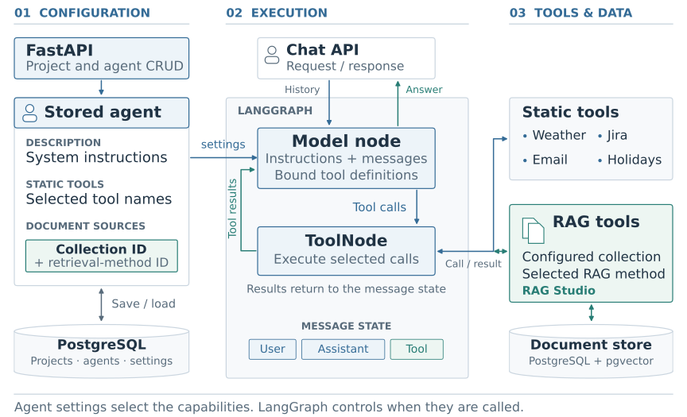
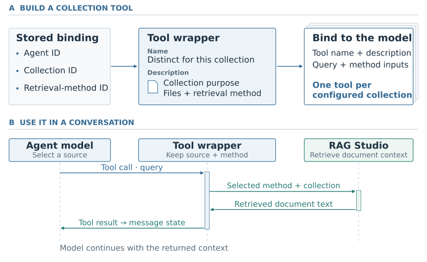
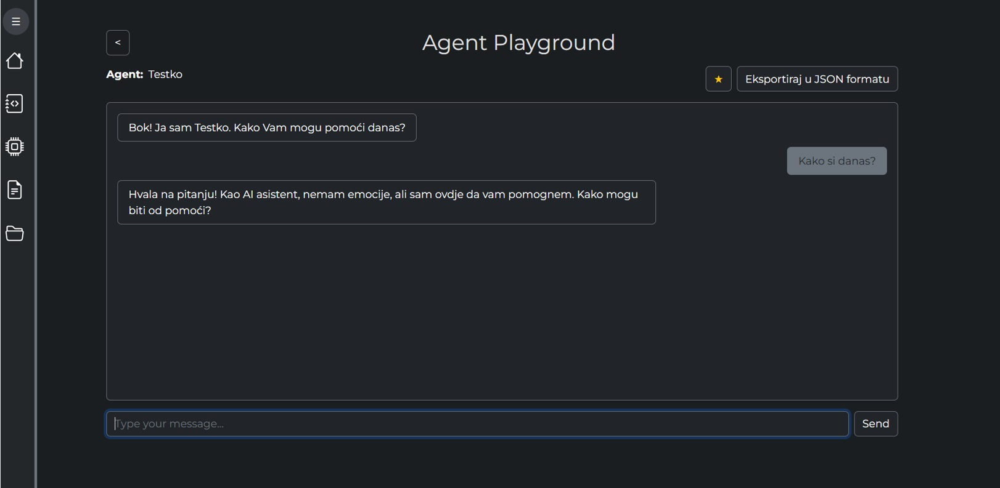

# AI Agent Factory — Agent Studio

AI Agent Factory lets users configure agents with their own instructions, tools and document collections, then test them in a chat interface. I worked on the **Agent Studio backend** during Abysalto AI Academy. My main integration connected it to **RAG Studio**, so an agent could search its configured document sources during a conversation.

**Python · FastAPI · Pydantic · SQLAlchemy · PostgreSQL · LangGraph · LangChain · pytest**

*Abysalto AI Academy · Summer 2025 · Six interns in two teams*

## Architecture

An agent's settings determine its system prompt, available tools and document sources. The backend loads those settings and builds a LangGraph execution graph. The model can answer directly or call a tool, read the result and continue.

**Figure 1.** How agent configuration becomes an executable agent. The return path carries tool results back into the conversation. [Agent framework](docs/agent-framework.md).

## My work

### Agent configuration and execution

I built CRUD APIs for projects and agents, including the Pydantic schemas, SQLAlchemy models and database operations behind them. I also worked on the configuration records linking an agent to a document collection and its selected retrieval method. Those relationships let each agent keep its own document sources and search settings.

On the execution side, I worked on the LangGraph model/tool loop, tool selection and chat handling. I used the agent description as its system prompt and loaded the selected tools from its configuration. This let users change an agent's instructions and capabilities through the application.

### Connecting Agent Studio to RAG Studio

The two studios had different jobs: RAG Studio processed documents and retrieved context; Agent Studio managed agents and their conversations. I connected them by wrapping retrieval as a **LangChain tool for each configured collection**. Each wrapper kept the collection and selected retrieval method together, then passed the model's query to RAG Studio.

**Figure 2.** A document collection exposed through the agent's tool interface. The model sees a tool description; the wrapper keeps the collection and retrieval method attached to the call. [RAG integration](docs/rag-integration.md).

I added collection and file descriptions to help the model choose where to search. Retrieval stayed in RAG Studio, while the agent used the returned text in the same execution loop as its other tool results.

### Tools, ratings and API tests

I worked on the common tool interface, integrated the weather tool and added an API for listing available static tools. The team's tool catalogue also included Jira, SMTP email and public-holiday information.

For agent feedback, I added cumulative rating sums and counts so each submitted score contributed to the average. I also wrote **14 router test cases** for the Agent and Project APIs, covering CRUD operations, missing records, duplicate project names and rating calculations. The platform's LLM-based conversation evaluation was developed by other team members. [Ratings and test coverage](docs/testing-and-ratings.md).

## Agent Playground

**Figure 3.** The shared application's chat interface. Image from the team presentation, also published in [Roko Čubrić's project overview](https://github.com/roko-cubric/AI-Agent-RAG-Platform).

## Team

Six interns worked in two teams of three. I was part of **Agent Studio**, which covered agent configuration, execution and tool use. The **RAG Studio** team developed document processing and retrieval. My integration work connected the two through collection configuration and callable retrieval tools.

## Repository guide

| Guide | Contents |
| --- | --- |
| [Agent framework](docs/agent-framework.md) | Data model, APIs and the LangGraph execution loop. |
| [RAG integration](docs/rag-integration.md) | Collection bindings, tool descriptions and retrieval calls. |
| [Ratings and API tests](docs/testing-and-ratings.md) | Rating calculations and the 14 router test cases. |

*Source code belongs to Abysalto. This repository presents the architecture and my contributions.*
