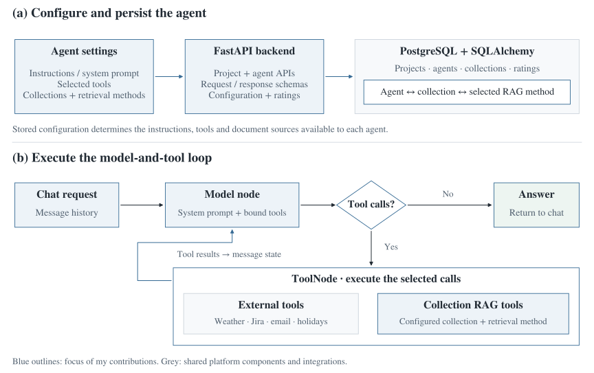
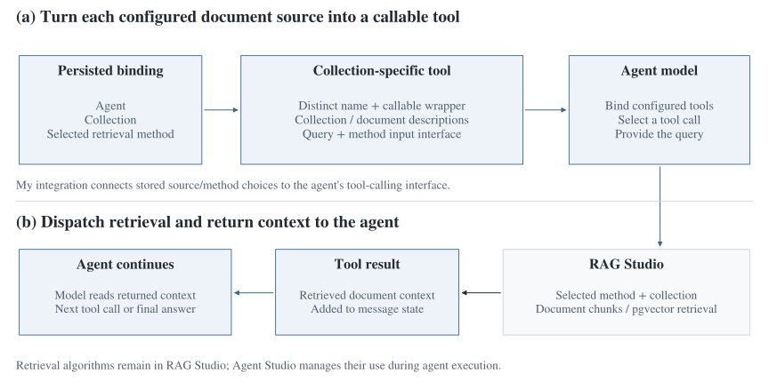

# AI Agent Factory — Agent Studio

Users could configure an AI agent with its own instructions, tools and document collections, then test it in a chat interface. I worked on the **Agent Studio backend** and the integration that exposed **RAG Studio retrieval as tools the agent could call**.

**Python · FastAPI · SQLAlchemy · PostgreSQL · LangGraph · LangChain · API testing**

*Abysalto AI Academy · Summer 2025 · Six interns in two teams*

## Architecture

The backend stores each agent's configuration and uses it to build the execution graph for a conversation. The model can answer directly or call a configured tool, read its result and continue.

**Figure 1.** Configuration, persistence and execution in the shared platform. Blue outlines mark the areas of my contributions. Retrieval methods, document processing and external integrations sit behind the tool interfaces. [Agent framework and data model](docs/agent-framework.md).

## What I worked on

| Area | My contribution |
| --- | --- |
| **Project and agent APIs** | Implemented CRUD routes, request/response schemas and data operations for projects and agents. |
| **Persistence and configuration** | Worked on SQLAlchemy models and the records connecting an agent, a document collection and its selected retrieval method. Added configuration routes and later refactored the model and API logic. |
| **Agent execution** | Developed the LangGraph agent/tool integration, selected tools from agent configuration and used the agent description as its system prompt. Worked on chat handling and thread-related fixes. |
| **RAG Studio integration** | Connected stored collection configurations to retrieval methods and wrapped collection retrieval as LangChain tools. Enriched tool descriptions with collection and document information so the model could choose among the configured sources. |
| **Tool interface** | Worked on the common tool abstraction, weather-tool integration and the API exposing available static tools. The shared platform also included Jira, email and public-holiday tools. |
| **Ratings and tests** | Added cumulative rating sums and counts for average user ratings. Wrote 14 Agent and Project router test cases covering creation, lookup, updates, deletion, error responses and rating behaviour. |

## Connecting the two studios

The integration had to preserve both the **document source** and the **retrieval method** selected for an agent. A generic search function would not carry enough information to make that choice.

**Figure 2.** The RAG tool bridge. Each configured collection becomes an agent-callable tool. The wrapper delegates retrieval to RAG Studio and returns the retrieved context to the model. [Configuration, tool descriptions and retrieval dispatch](docs/rag-integration.md).

This kept retrieval implementations in RAG Studio while letting Agent Studio use them through the same calling interface as its other tools.

## Agent Playground

**Figure 3.** The shared application's chat interface. My work described here concerns the backend. Image from the team presentation, also published in the [RAG Studio project overview](https://github.com/roko-cubric/AI-Agent-RAG-Platform).

## Ratings and testing

User ratings are stored as a sum and count, with their average updated after each submitted score. The Agent router tests cover that aggregation alongside CRUD behaviour; the Project tests cover creation, duplicate handling, lookup, update and deletion.

The shared platform also included LLM-based scoring of agent conversations and tool traces. That is separate from the user-rating aggregation and router tests described as my work. [Rating model and test coverage](docs/testing-and-ratings.md).

## Team and scope

Six interns worked in two groups of three. **RAG Studio** handled document processing and retrieval. **Agent Studio**, my team, handled agent configuration, execution and interaction with tools. Connecting the studios required coordination around collection configuration, retrieval interfaces and the context passed back to the agent.

## Repository guide

| Guide | Contents |
| --- | --- |
| [Agent framework](docs/agent-framework.md) | Configuration, APIs, persisted relationships and the model/tool execution loop. |
| [RAG integration](docs/rag-integration.md) | How a configured collection and retrieval method become an agent-callable tool. |
| [Testing and ratings](docs/testing-and-ratings.md) | User-rating aggregation, API test cases and the distinction from shared LLM evaluation. |

*Source code belongs to Abysalto. This repository documents the architecture and my contributions.*
