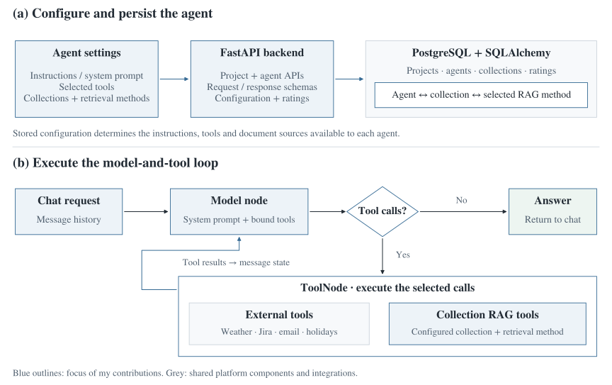

# Agent framework

[Overview](../README.md) · [RAG integration](rag-integration.md)

Agent Studio lets a user configure an agent and then interact with it through the chat API. The backend connects stored configuration to the model's instructions, available tools and document sources.

## Configuration and persistence

| Record | Information used by Agent Studio | Relationship |
| --- | --- | --- |
| **Project** | Name and description. | Groups agents and document collections. |
| **Agent** | Name, description, selected tool names, project reference and rating fields. | Belongs to a project and has collection configurations. |
| **Agent–collection configuration** | Agent reference, collection reference and retrieval-method identifier. | Selects the document source and retrieval method available to that agent. |
| **Collection** | Description, files, chunking and embedding configuration. | Supplies document context through the selected RAG method. |

I implemented project and agent CRUD, configuration routes, schemas and model changes. Updates to agent configuration also had to account for its collection relationships, so that selected sources and retrieval methods stayed connected to the intended agent.

The shared backend uses FastAPI, Pydantic schemas and SQLAlchemy with PostgreSQL. RAG Studio manages the document, chunk and vector-retrieval components; Agent Studio consumes that functionality through collection-specific tools.

## From configuration to an executable agent

1. **Load the agent.** Read its description, selected static tools and collection configurations.
2. **Prepare the instructions.** Use the agent description as the system prompt.
3. **Build the tool set.** Select configured static tools and construct RAG tools for the configured collections.
4. **Bind tools to the model.** Expose their names, descriptions and input interfaces for model tool calls.
5. **Build the graph.** Connect the model node to tool execution and a completion branch.
6. **Run the conversation.** Supply the message history from the request and return the resulting answer.

My changes covered the agent/tool integration, per-agent instructions, chat handling and the connection to configured RAG methods. The team continued to develop the shared runtime and its supporting services.

## Model and tool loop

The graph starts at the model node. If the model returns tool calls, the tool node executes them and adds their results to the message state. Control returns to the model, which can make another call or produce the final response.

This separates three responsibilities:

| Part | Responsibility |
| --- | --- |
| Agent configuration | Select which tools and sources are exposed to the model. |
| Model node | Interpret the messages and decide whether to answer or request a tool. |
| Tool execution | Run the selected operation and return its result as conversation context. |

Conversation messages are part of the graph state. The chat API receives message history with each request and uses a per-call thread identifier for execution.

## External tools

The common tool interface supplies a name, description, execution behaviour and a LangChain-compatible adapter. The model sees the configured subset of tools rather than every available integration.

I worked on this interface, weather-tool integration and the available-tools API. Other team contributions extended the tool catalogue with Jira, SMTP email and public-holiday information. These tools use the same agent execution path as document retrieval.

## API responsibilities

| API area | Behaviour |
| --- | --- |
| Projects | Create, list, retrieve, update and delete projects. |
| Agents | Create and manage agents; expose their selected tools and collection configurations. |
| Tools | List the available static tool definitions for configuration. |
| Chat | Load the configured agent, run its graph and return the response. |
| Ratings | Accept user scores and expose the accumulated average. |

[Ratings and API tests](testing-and-ratings.md) · [Overview](../README.md)
