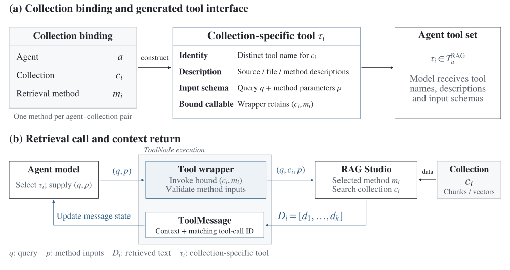

# Connecting Agent Studio and RAG Studio

[Overview](../README.md) · [Agent framework](agent-framework.md)

RAG Studio stored document collections and provided the methods for searching them. My work connected those methods to Agent Studio, where the model needed to choose and call a document source during a conversation.

## Keeping the source and method together

An agent can use several document collections, each with its own selected retrieval method. I worked on the configuration that records these choices and the mapping used to build the agent's tools. Each binding contains an **agent ID, collection ID and retrieval-method ID**.

The wrapper holds onto the collection and method while exposing a callable tool to the model. When a query arrives, it passes the query to that method for that collection. The agent runtime can use the result without implementing the retrieval algorithm itself.

## Giving the model enough information to choose

A tool name identifies a callable operation, but the description tells the model when it might be useful. I worked on descriptions that included the collection's purpose and information about its files. This gave the model information about the available sources before it made a retrieval call.

| Tool component | Purpose |
| --- | --- |
| Distinct name | Identifies the collection-specific operation in a tool call. |
| Collection and file descriptions | Explain what information the source contains. |
| Retrieval-method description | Explains the search capability available for that source. |
| Query and method inputs | Supply the search request to the wrapper. |
| Bound collection and method | Preserve the source and retrieval choices stored for the agent. |

I integrated these retrieval tools with the agent's selected static tools and the LangGraph execution loop. The shared implementation later added method-specific parameter schemas and further service refactoring.

## From a tool call to document context

The model selects a tool and supplies its query. The wrapper calls the configured retrieval method, which reads from the collection's document data in RAG Studio. The returned text becomes a tool result in the conversation. The model can then use that context in its answer or make another tool call.

The division of work followed the two studios:

| Agent Studio — my integration | RAG Studio — retrieval team |
| --- | --- |
| Store an agent's collection and method choices. | Process documents, create chunks and generate embeddings. |
| Build and describe collection-specific tools. | Implement retrieval methods and their parameters. |
| Bind those tools to the agent model. | Store and retrieve document chunks with PostgreSQL/pgvector. |
| Return retrieval results to the model/tool loop. | Prepare the document context requested by the tool. |

[Agent framework](agent-framework.md) · [Ratings and API tests](testing-and-ratings.md)
